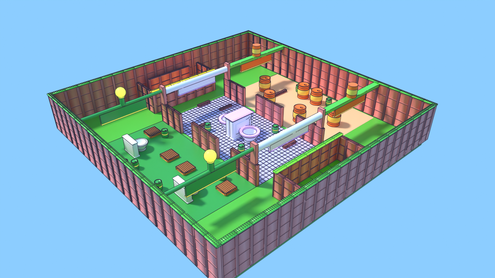

# Fart-Wars

**Fart Wars** is a Roblox team game: the **Skibidi Stinkers** (toxic green)
against the **Sigma Sharters** (bright yellow) on the Brainrot Battlefield.

This repository holds **Phase 1** (the foundation), **Phase 2** (combat
and chaos) and **Phase 3** (progression and economy) of the six-phase
masterplan. Two or more players join a running
server, press PLAY, land on balanced teams, and blast each other with the
Gas Blaster on a symmetrical three-lane map until someone inflates and
explodes. Five-minute rounds end in a win or draw, a 15-second intermission
follows, and the next round starts with no server restart. Continuous play
(no rounds) is one setting away. Eliminations, assists, streaks and time
played earn coins and XP toward levels 1-50, saved between sessions;
coins buy three more weapons, levels unlock two Q abilities and tracer
cosmetics, all equipped from the locker.

## Getting started

1. Install [Rojo](https://rojo.space) 7.4 or newer (older 7.x releases skip
   `.luau` files) and its Studio plugin.
2. Create a place named **Fart Wars - Development** and keep the experience
   **private** while testing. Turn on Team Create if you're collaborating.
3. In **Game Settings → Places**, set **Max Players** to **20**. A script
   can't set this; the server warns in the output if it's anything else.
4. Run `rojo serve` in this folder and connect from the Studio plugin.
5. Press **Play** to try it alone, or **Test → Clients and Servers** with two
   or more players for a real round. With one player you stay in WAITING;
   a second player on the other team starts the round.
6. To test saving in Studio, publish the place once, then turn on **Game
   Settings → Security → Enable Studio Access to API Services**. Without
   it the game still runs, on temporary profiles that never save (the HUD
   says so, and the output warns once).
7. Chat `/fw selftest`: it checks the place settings, the map, remotes,
   teams, DataStore access and chat on the real server, one line each in
   the output. Then work through
   [`docs/studio-signoff.md`](docs/studio-signoff.md), the Studio sign-off
   for Phases 1-3.

Studio publishes to the private experience as usual. Nothing in this
repository holds credentials or API keys, and nothing should.

## How it plays

| Rule | Phase 1 |
| --- | --- |
| Teams | Skibidi Stinkers vs Sigma Sharters |
| Capacity | 20 connections; at most 10 active players a team |
| Start | at least 2 active players and nobody alone without an opponent (1v1 is fine) |
| Rounds | 5 minutes, then 15 seconds of results, on a server that keeps running |
| Joining mid-round | PLAY puts you straight into the current round |
| Team choice | only when it doesn't make the teams less even |
| Friends | break a tie between equally fair teams, nothing more |
| AFK | warning at 45 seconds ("BRO FELL ASLEEP MID-FART!"), spectator at 60, slot freed |
| Camera | third person over the right shoulder; V toggles first person. In a match the mouse is locked to the crosshair; Left Alt frees it |
| Home screen | the live battlefield behind the menu; you spectate until PLAY |
| Result | most validated eliminations wins; level scores are a draw |
| Combat | the Gas Blaster: 20% gas a body hit, 25% to the head, 0.3 s between shots; friendly fire off. Long shots do less: full gas out to a weapon's effective range, half at its full range (the server measures the distance) |
| Weapons | Gas Blaster (starter, all-round: full gas to 120 studs, half by its 260-stud range), Spritzer (level 5, 400 coins: 9% (11% to the head) at 10 shots a second, out-eliminating the Gas Blaster up close, full gas to 45 studs, nothing past 90), Thunderclapper (level 15, 3,000: 40% / 55% to the head, one a second, full gas to 240 studs, half by its 420-stud range, slower walk), Stink Lobber (level 25, 7,000: a bomb lobbed over cover up to 150 studs, 15% splash and a 4-second cloud that gasses enemies in it) |
| Abilities | Shift: Fart Dash (everyone). Q, one equipped: Recovery Burst (level 10: vent 35% gas, 20 s) or Gas Pulse (level 30: after a 0.4 s wind-up, 15% to enemies within 12 studs, 25 s). One cooldown whichever is equipped; a death resets it |
| Shop and loadouts | prices and levels checked on the server; a purchase is saved before it's confirmed. Weapon and ability changes made mid-fight wait for the next respawn; tracers apply at once |
| Gas | replaces health. Stages at 25 / 50 / 75%; at 100% a one-second countdown, then the explosion. Five seconds without taking gas, it drains 5% a second |
| Eliminations | the last enemy to add gas scores; others from the last 10 seconds assist. Five in a row without dying: the whole server hears "BRO IS THE ALPHA FART!" |
| Explosions | an exploding player blasts 40% gas onto the killer's enemies within 14 studs (not through walls), credited to the killer; chains stop after 4 steps |
| Barrels | 12 gas barrels in the middle. Two shots light the fuse; 0.6 s later they blast 40% gas onto the last shooter's enemies within 16 studs, set off nearby barrels, and come back 20 s later |
| Spawning | the team's pad farthest from enemies; 3 seconds of protection, ended by firing; respawn 3 seconds after a death |
| Match mode | `FeatureFlags.MATCH_MODE`: `"Rounds"` (default) or `"Continuous"` (join straight onto a team, no timer, scores run on) |
| Coins and XP | elimination 10 coins / 20 XP, assist 5 / 10, chain or barrel kill +5 coins, the 5-kill streak 50 / 100, 5 and 10 minutes of play 25 / 50 and 75 / 100 (once a session). Coins are spent in the shop; XP only levels you up |
| Levels | 1 to 50: 100 XP a level at first, rising ever faster (730 at level 24, 4,090 at 49; 61,640 in all). Pacing and the model that checks it: [`docs/economy.md`](docs/economy.md). Unlocks at 5, 10, 15, 20, 25, 30, 40 and 50; level 50 pays 1,000 coins and the Alpha Farter badge, then 250 coins every 5,000 XP |
| Mastery | 25 / 75 / 150 / 300 eliminations with a weapon: a badge and 100 / 250 / 500 / 1,000 coins each, once |
| Saving | profiles in a DataStore, locked to one server at a time, autosaved every minute and on leaving or shutdown |
| Daily rewards | a 7-day track (100 to 500 coins, a free spin on days 3 and 6, the Stink Sparkle tracer on day 7), one claim per UTC day; it loops, and a missed day doesn't reset it |
| Free spins | one for every 10 minutes of active play (6 a day, banked up to 10), plus the daily ones; every prize's chance is on the spin screen |
| Cosmetics | tracers (your shots' colour), Fart Dash trails and emotes (E, over your head); from levels, the daily track, the spin and the store. None changes combat |
| Store | the Starter Pack (a tracer, a trail, an emote, 500 coins once) and coin packs; nothing for sale changes combat. Set the IDs in `MonetizationConfig` to sell them; until then the store shows them as unavailable |

**Controls (PC):** WASD move, mouse aim, left click fire, Shift Fart Dash,
Q ability (once unlocked), 1-4 pick a weapon from the hotbar, E emote, Space jump,
V first/third person, Left Alt free the mouse (again to lock it), M menu,
Tab (hold) scoreboard. R and F are kept free for later mechanics. In a match
the mouse is locked to the crosshair in both views (third person sits over
the shoulder); Alt frees it, and every screen with buttons frees it while
it's open. Settings → 3rd person mouse lock off gives a free cursor in third
person.

**On screen:** score boxes in each team's colour either side of the timer;
coins and the Shop / Abilities / Levels / Settings buttons top right; the
gas bar and the Fart Dash charge over a hotbar (your weapons in slots 1-4,
your ability on Q with its cooldown) and the level bar along the bottom.
Your weapon is in your avatar's hands. Where your shots land, the gas they
put in floats up ("+20%", gold for a headshot); a chain reaction you set
off counts up big ("CHAIN x2!", "CHAIN x3!"), and players near someone
else's see a smaller line. PLAY opens "Choose a Team": each
team's card shows its count and is locked when joining it would be unfair. The first PLAY of a session shows a
small controls card; there's no tutorial. Bindings live in
`UIConfig.keys`.

**Round states:** WAITING → ACTIVE (300 s) → RESULTS (15 s) → ACTIVE, or back
to WAITING when there aren't enough players. A round in progress always
finishes, even if a whole team leaves. The server owns every timestamp;
clients get a snapshot with an absolute end time and work out the countdown
from the server clock, so lag never stretches a round.

**Player states:** MENU_SPECTATOR (just joined, or chose to spectate),
ACTIVE (on a team with an avatar) and AFK_SPECTATOR (moved off their team
for being idle). Only ACTIVE players have an avatar or a team slot. The
server sets the state; clients read it from the Player's `State` attribute.

## Project structure

Rojo maps the source like this (`default.project.json`):

| In Studio | Source | What it is |
| --- | --- | --- |
| `ReplicatedStorage.Shared.Config` | `src/shared/Config` | `GameConfig`, `FeatureFlags`, `TeamConfig`, `MapConfig`, `WeaponConfig`, `AbilityConfig`, `ProgressionConfig`, `RewardsConfig`, `MonetizationConfig`, `ExperimentConfig`, `ReleaseConfig`, `PrestigeConfig`, `SeasonConfig`, `EventConfig`, `WeaponArt`, `PropArt` and `ShotArt` (generated from Blender), `MapArt`, `WeaponFx`, `ArtAssets`, `AudioConfig`, `UIConfig` |
| `ReplicatedStorage.Shared.Interfaces` | `src/shared/Interfaces` | `MapBase`, `GameModeBase`: the contracts maps and modes keep |
| `ReplicatedStorage.Shared` | `src/shared` | `TeamBalance` (the team rules), `RoundClock`, `States`, `Signal`, `WeaponModel` (the weapons from the Blender art), `MeshBuilder` (builds the Blender meshes in the game) |
| `ReplicatedStorage.Shared.MeshData` | `src/shared/MeshData` | the weapon and shot meshes, packed (generated from Blender) |
| `ReplicatedStorage.Assets.Weapons`, `Assets.Props`, `Assets.Effects` | Studio (Rojo leaves them alone) | the Blender meshes, if imported ([`art/README.md`](art/README.md)) |
| `ReplicatedStorage.Remotes` | `default.project.json` | `RequestPlay`, `RequestTeam`, `RequestSpectate`, `RoundSnapshot`, `RoundUpdate`, `TeamUpdate`, `UIMessage`, `FireWeapon`, `FartDash`, `CombatEvent`, `ProgressEvent`, `UseAbility`, `ShopRequest`, `ProfileUpdate`, `RewardsRequest`, `Emote`, `ReportPlayer`, `ClientReport`, `PrestigeRequest` |
| `ServerScriptService.Server` | `src/server` | `Bootstrap.server.luau`, `Telemetry`, `Health`, `Profiler`, `Moderation`, `TestControls`, `Messages`, `RateLimit`, `Cadence`, `MapDressing` (the map's Blender props) |
| `ServerScriptService.Server.Services` | `src/server/Services` | the services below |
| `ServerScriptService.Server.Modes` | `src/server/Modes` | `TeamElimination` (the default) and `GasControl` |
| `ServerStorage.Maps` | `src/maps` | `BrainrotBattlefield`, built from code with `MapKit` (the shared map pieces) |
| `StarterPlayerScripts.Client` | `src/client` | `ClientBootstrap`, `ClientState`, `UI`, `ShotFx` (what shots look like), `WeaponSkin` (dresses held guns in the meshes), `GasNumbers` (the gas your shots put in, floating up where they land) and the controllers |

The screens (`HomeScreen`, `HUD`, `ResultsScreen`, `Scoreboard`,
`Progress`, `Locker`, plus `GameMenu` and `ComingSoon`) are built in code by the client controllers
rather than stored in `StarterGui`, so they live in Git like everything
else.

### Services

| Module | Owns |
| --- | --- |
| `RoundService` | the match state, server timestamps, the start threshold, the timer, results and intermission; publishes snapshots |
| `TeamService` | active team counts and Roblox `Team`s; checks every join, leave, spectate and switch against `TeamBalance`; friend preference |
| `PlayerLifecycleService` | each player's runtime state; PLAY, spawning, safe respawns, spectating, leaving; no avatar ever outlives its slot |
| `AFKService` | the 45/60-second warning and spectator move, judged on the server |
| `MapService` | loads the map template, checks it against `MapBase`, picks safe spawns; ready for map rotation |
| `MatchScoreService` | this round's scores, frozen the moment a round ends; the test-only elimination input |
| `CombatService` | the Gas Blaster: checks each shot (state, interval, shot numbers, payload), casts it on the server, sends hits to GasService; logs suspicious accuracy and movement |
| `GasService` | the gas meter: enemy-only gas, protection, recovery, the countdown and the explosion, killer and assists |
| `EliminationService` | each death credited exactly once, with an event ID; streaks and the alpha announcement |
| `ExplosionService` | blasts from explosions: gas to the owner's enemies in range and in sight, chain depth limit, a per-tick budget; each blast carries its chain reaction (`Chain`), whose count every explosion sends |
| `BarrelService` | gas barrels: health, fuse, ownership by the last shot, blasts, respawn |
| `DashService` | Fart Dash: cooldown and travel checks |
| `AbilityService` | the Q ability: checks (state, equipped, exploding, cooldown), Recovery Burst's vent, Gas Pulse's wind-up and blast |
| `ProjectileService` | stink bombs: the server-flown arc, the splash, the clouds and their ticks |
| `DataService` | player profiles: session-locked loads with retries, migrations, autosave, leave and shutdown saves, temporary profiles when DataStores are down; the only module that touches the DataStore |
| `EconomyService` | coins, XP, levels and unlocks, the cap rewards, participation, mastery and lifetime stats; every grant has a unique ID, limits and a ledger entry; spending and refunds |
| `LoadoutService` | the equipped weapon, ability and tracer: owned items only, applied on each spawn (mid-fight changes wait), the profile view for the screens |
| `ShopService` | `ShopRequest`: purchases (server prices and checks, saved before confirming, rolled back on a failed save) and equipping |
| `MonetizationService` | the store: coin-pack receipts (paid once, saved before "granted", retried when they can't be), passes (given once when owned) |
| `PrestigeService` | `PrestigeRequest` (behind `FeatureFlags.PRESTIGE`): an exact preview with a confirmation token, then the reset, saved before it's confirmed and undone if the save fails; cosmetic rewards only |
| `SeasonService` | the free seasonal track (behind `FeatureFlags.SEASONS`): season XP, tiers paid once, weekly challenges from real play, new weeks and seasons |
| `EventService` | live events (behind `FeatureFlags.EVENTS`): Bean Rain, announced, on the lanes only, capped, beans paying coins and a Fart Dash |
| `ZoneService` | Gas Control's zone: who's in it, who holds it, a point a second for a team alone in it, holders' rewards; the HUD's zone line and the floor ring |
| `MetricsService` | live metrics by segment (new or returning, paying or free): the onboarding funnel (also sent to Roblox's), eliminations and deaths, session lengths, coin sources and sinks (sent to Roblox's economy events) |
| `ExperimentService` | retention experiments: each player's cohorts (from their user ID), the values they get (gift timing, early prices, tips), telemetry by cohort; all off as shipped |
| `SocialService` | playing with friends: the squad bonus (a friend on your team), the one-time newcomer welcome, co-play counts |
| `RewardsService` | `RewardsRequest`: the daily track, ten-minute gifts (active play only, capped per day), free spins drawn by published weights; every claim recorded before it pays |
| `Telemetry` | structured `[FW]` logs, counters, errors per service, rejected requests by remote and reason, abnormal request rates, flags for review, time to first shot / hit / elimination / purchase, the return rate |
| `Moderation` | acts on flags (abnormal requests, accuracy, movement, coins, dashing through walls, reports from several players): review only by default, or a kick at `GameConfig.MODERATION.KICK_AT_FLAGS`; turns away `BANNED_USER_IDS`; `ReportPlayer` (fixed reasons, once per person, a few a session) |
| `Health` | runs the service loops (an error in a tick is counted and reported, and the loop goes on); checks loops, errors per minute, frame rate, memory and saving every 30 seconds; Workspace's `ServerHealth`; `ClientReport` (clients' frame rate, ping, errors) |
| Client controllers | `InputController`, `CameraController`, `CombatController` (crosshair, gas and dash bars), `ChainController` ("CHAIN x2!" pop-ups), `EffectsController`, `HUDController` (score boxes and timer), `ProgressController` (level bar, rewards), `LockerController`, `HotbarController` (weapons 1-4, Q), `MenuBarController` (coins, menu buttons), `TipsController`, `PlayersController` (block, hide emotes, report), `HealthController` (the client's report), `HomeController` (home screen, Choose a Team, the version): render, capture input, switch camera, fire, dash and use abilities, ask the shop; they never decide teams, hits, results, rewards or purchases |

`Bootstrap.server.luau` loads them in dependency order. No module requires
one that depends on it (the specs fail on a require cycle).

### Remotes

Clients only state intent: PLAY (with an optional team), a team choice or
switch, spectate, which way they're aiming, a dash, Q, a purchase or an
equip. The server re-checks
state, capacity, eligibility, fire interval, payload types and a per-player
cooldown, casts every shot itself, and never accepts a hit, score, timer or
team count from a client, and there's no remote at all for coins, XP or
levels, and a purchase sends only the weapon's ID. `RoundSnapshot` and
`ShopRequest` answer requests; `RoundUpdate`, `TeamUpdate`, `UIMessage`,
`CombatEvent`, `ProgressEvent` and `ProfileUpdate` go from the server to
clients. Exact payloads are in
[`docs/implementation-packet.md`](docs/implementation-packet.md).

## Brainrot Battlefield v0

A 160 × 160 stud layout built three times bigger (480 × 480 studs, room
for 20 players; `MapConfig.scale`), mirrored across the centre line so
neither side has a better layout (`src/maps/BrainrotBattlefield.luau`):

- **Three lanes** split by divider walls with two gaps each: **Bean Alley**
  (giant bean cans), **Porcelain Plaza** (a back-to-back giant toilet throne
  at the centre) and **Gas Gutter** (crates, a sideways toilet, barrel
  clusters).
- **Cover in two heights.** Tall cover (the throne, the bean cans, the
  Gutter's toilet) grows with the map and hides you whole. Low cover (the
  plaza and alley walls at 5 studs, the crates at 6) keeps its avatar
  height while its footprint grows: duck behind it, shoot past its ends or
  jump to fire over it, lob over it. It's marked `KeepHeight`, which
  `MapKit.scale` honours.
- **Lane gates.** Each lane's entrance, on both halves, has a gate up on
  the walls' tops: the lane's name on a sign that reads both ways, a
  coloured light, and a landmark on top (a giant bean can, a toilet roll
  with its paper hanging down as the sign, a gas vent puffing green). Coming
  out of a spawn corridor you see the side lane's sign ahead. The gates are
  decor above the dividers, so they never block a shot, a path or a
  sightline anyone plays along (`Landmarks`).
- **Spawn rooms** at each end, walled at the front and sides with their
  doors at the back. Nothing in the lanes or the enemy half can see a pad,
  standing or up on low cover (the Map spec checks over 22,000
  sightlines, and counts only walls and cover).
- **Gas barrels** sit in the contested middle, never by a spawn, one
  `GasBarrel` model each in the `Barrels` folder.
- **Launch pads** (`FeatureFlags.LAUNCH_PADS`): giant whoopee cushions that
  fart whoever steps on one forward and up along a fixed arc, with a
  puff, a sound and a green cloud. Four a half, mirrored: one at the start
  of each side lane beside the spawn room, thrown up the lane to just
  short of its gap into the plaza, and one at each front corner of the
  spawn room, thrown into Porcelain Plaza short of the throne. Every arc
  stays on its own half, under the gates and clear of the walls and
  cover. A pad is a `LaunchPads` model (the cushion, and the `Target`
  column standing on the landing spot as tall as the arc's peak); the
  client launches its own avatar and the server checks it
  (`LaunchPadService`), with a short cooldown, and its movement checks
  allow for the flight. Bots take a pad they walk onto its way.
- `Zones` marks the lanes and spawn areas, `CameraPoints` holds the home
  screen's fixed views, and `Bounds` is the playable box.

To replace it with a map built in Studio, put a Model named
`BrainrotBattlefield` in `ServerStorage.Maps` (and remove the module) with
`Spawns/Stinkers`, `Spawns/Sharters`, `CameraPoints` and `Bounds` as
described in `src/shared/Interfaces/MapBase.luau`. MapService sets the
SpawnLocations up for their teams and refuses a map that breaks the
contract. A new map is a `MapConfig` entry plus its template.

## Test-only controls

These exercise rounds, spawning and combat without waiting for the real
thing. They run on the server only. In Studio anyone can use them; in a live server, only the user
IDs in `GameConfig.TEST_CONTROLS.USER_IDS` (empty by default). **Set
`GameConfig.TEST_CONTROLS.ENABLED` to `false` before any public release.**

Chat (`/fw` or `!fw`):

```
/fw score stinkers 3     three eliminations for a team (stinkers/green, sharters/yellow)
/fw end 5                end the current round or intermission in 5 seconds
/fw reloadmap            rebuild the map; active players respawn on it
/fw idle 44              count yourself as idle for 44 seconds (to see the AFK warning)
/fw spawn                respawn (or PLAY from the home screen)
/fw team sharters        move to a team whatever the balance, and respawn
/fw resetgas             empty your gas meter
/fw gas 95               set your gas (100 starts your countdown)
/fw weapon spritzer      give yourself a weapon (saved for real) and hold it now
/fw ability gaspulse     unlock and equip a Q ability
/fw barrels              every gas barrel back, full
/fw coins 500            coins through the normal grant path (ledger and all)
/fw xp 1000              XP the same way (level-ups, unlocks)
/fw profile              your saved progress, and whether it's saving
/fw selftest             checks this server: settings, map, remotes, teams, DataStores, chat
/fw daily                today's daily reward claimable again
/fw spins 3              free spins
/fw stats                shots, hits, eliminations a minute, barrel and chain kills,
                         spawn deaths, dashes, gas recovered, coins and XP granted,
                         temporary profiles, save failures, rejected requests, errors
```

Or the server command bar in Studio, with the same words and an optional
player (the first one otherwise):

```lua
local fw = game.ServerScriptService.Server.TestControls.Command
fw:Invoke("selftest"); fw:Invoke("end 5"); fw:Invoke("score stinkers 3")
fw:Invoke("gas 95", game.Players.Player1); fw:Invoke("weapon spritzer", game.Players.Player2)
```

Don't `require` TestControls there: the command bar gets its own fresh
copy of every module, so the calls would change nothing in the running
game.

## Tests

The specs in `tests/` run without Studio, on the Luau CLI, against stand-ins
for the Roblox engine (`tests/local/harness.luau`, with a virtual clock so a
five-minute round takes no real time):

```
python3 scripts/run_specs.py            # all specs
python3 scripts/run_specs.py QAMatrix   # one spec
```

They need `luau` on your PATH (`brew install luau`, or a release from
[luau-lang/luau](https://github.com/luau-lang/luau/releases)).

| Spec | Covers |
| --- | --- |
| `QAMatrix` | the plan's QA matrix, row by row, on one 20-player server |
| `Combat` | two players fight with the Gas Blaster: body and head hits, no spawn kills, the countdown and explosion, repeated deaths, friendly fire, walls, refused and duplicate shots, Fart Dash, test commands, telemetry |
| `Gas` | gas stages, clamping, recovery and its interruption, 99 to 100, simultaneous hits, assists, leaving or spectating mid-countdown, no double kills |
| `Streak` | "BRO IS THE ALPHA FART!" once at five, resets, two at once; the client's banner, inflation and effect pool |
| `Chaos` | chain reactions and their depth limit, blasts sparing the killer's team and stopped by walls, the per-tick budget, barrels (fuse, blast, credit, respawn), barrel-player-barrel chains |
| `Data` | saving against a stand-in DataStore: defaults, autosave, leave and rejoin, session locks (waiting, taking a stuck or stale one, losing one), outages, newer saves, migrations, failed writes, leaving mid-load, rejoining mid-save, shutdown, ten joins at once |
| `Economy` | every grant and its limits, no double rewards, level-ups and unlocks to 50 and past it, mastery, participation (active time only), rewards before the profile loads, anomaly logging; the client's progress panel |
| `Store` | receipts (once, saved first, repeats, unknown products, absent players, failed saves and retries, the memory limit), passes (on joining and after buying, verified, once across sessions), cosmetic slots and emotes, the Store tab and cosmetics grid |
| `Rewards` | the daily track (once a UTC day, loops, no reset for missed days, spins and the day-7 tracer), gifts (active play only, the daily cap, the bank cap), spins (one each, the odds over 20,000 draws, the jackpot's tracer or coins once it's owned), unsaved sessions refused; the daily and spin screens |
| `Social` | the squad bonus (friends on one team only, the daily cap), the newcomer welcome (once ever, not between new accounts, the welcomer's daily cap and reset), co-play counts; cohorts (stable, by percent and weight, off as shipped), experiment values reaching the gift timer, shop prices (paid and shown) and the tips default, telemetry by cohort |
| `Access` | team symbols (score boxes, cards, kill feed, Players screen, over teammates, off), HUD size (panels scale, backdrops don't, the limits), reduce motion, friends on the team cards |
| `Season` | off as shipped and between seasons; season XP from XP and challenges; every tier paid once with its cosmetics and the badge; weekly challenges (the same for everyone, doable, from real eliminations and dashes, once each); a new week and a new season; the screen and button; booms |
| `Events` | Bean Rain: off as shipped; booked by about half of rounds; the warning, the rings, never in a spawn room, the part cap; pickups (coins capped, the dash refilled on both sides), nobody gassed; ending by itself and with the round |
| `Prestige` | off as shipped; refusals (level, in a match, unsaved); the preview's exact numbers; tokens (made up, used, expired); a failed save putting everything back; the reset and everything kept; the rank's rewards and tags; climbing again; no power; the screen's two presses |
| `WeaponArt` | the Blender art for every weapon, its moving parts, and the packed meshes (each unpacking to its size, facing out); the held gun from the stand-in pieces and from imported meshes (sized and placed from the art, a sideways or missing import falling back); built in the game (a stand-in EditableMesh), every gun dressed in the meshes, the stand-in hidden, the hotbar too; equip, recoil, springs past rest, the twirl, sway and walk bob, the Thunderclapper's flash and camera kick, reduce motion, the tank's glow; the pump, the gauge's needle, the Stink Lobber's bomb; muzzle particles, lights and rings, impacts (light, ring), a hit's flash, barrel smoke, explosion smoke and rings, the particle budget; the hotbar's 3D icons and the locker's turning previews; shots: the bolt from the muzzle flying into its target, lighting and trailing smoke, the burst, splats on walls (never players), reduced effects, the imported and built meshes |
| `MapArt` | the map's Blender meshes: every prop modelled at its part's size (a module at one section of it) and used, every named part in the map; the plain map until imported; imported at any scale (or inside the importer's Model), each part dressed in its colour and material while it stays the invisible hitbox, so what collides or can be hit is unchanged; walls, trims and floors as modules along their parts, running along each wall, none stretched more than a quarter; low cover's walls and crates stretched across its wider footprint but never up or down, their imports still accepted; spawn pads still spawning; the thrones and the Gutter's toilet facing their bowls; barrels' meshes going and coming back without ever colliding; sideways or empty imports left out and reported; dressing twice; Bean Rain's bean mesh; selftest |
| `GasControl` | the mode and its HUD, zone points (alone, contested, empty), eliminations not scoring, holders' rewards and their cap, the result; rotation (off, small servers, taking turns); a map missing its zone |
| `Audio` | every sound's ID and mix (volume, pitch variety, how far it carries); flat sounds at their volume and a pitch in their range, Settings' sound and volume ruling everything; sounds in the world from where they happen, too far away not played, the voice pool (its size, a share per sound, freed when a sound ends or in time, the oldest reused, a lost anchor rebuilt); in the game, others' shots, blasts, throws, splats, abilities, dashes and emotes in the world, your own shots, hits, warnings, emote and throw flat (never echoed), the screens' sounds flat |
| `Network` | late shots at still and moving targets, lost, bunched and out-of-order shots, hit markers only from the server, hits by ping, the cloud, tracer and effect budgets, the profiler and `/fw perf` |
| `HitFeedback` | the hit marker at the crosshair, only on the server's verdict: body, headshot (bigger, gold, the hit sound pitched up), the hit that sets them off (bigger still, a ring) and one that did nothing (grey, silent); the pop, the fade, back-to-back hits; REDUCE MOTION and REDUCED EFFECTS |
| `GasNumbers` | the floating gas numbers on the real server: your own hits only, the server's amount where it landed, white, a headshot's bigger and gold, a bot's, the Spritzer's "+9%"; none for spawn protection, a teammate or someone going off; side by side, the pool, reduced effects and reduce motion |
| `ChainCallouts` | chain counts from the server (players, a bot and barrels, a branching chain keeping one count, a stink bomb starting none); "CHAIN x2!" and up for the chain's owner (tagline, colour, size, the sting's pitch, a camera kick that never turns the view); nothing guessed; the line near someone else's chain, not far away or over your own; reduce motion and reduced effects |
| `Metrics` | segments, the funnel (once per step, Roblox's for new players), fairness by segment, economy events and their types, a new payer, failing analytics, session lengths and early leavers, concurrent players |
| `Release` | the version and channel on every screen; health (every loop watched, a stopped loop FAILING and recovering, a tick's error counted and the loop going on, an error burst, saving's check, `/fw health`); client reports (averaged, junk and spam refused); player reports (reasons, not yourself, once each, the session cap, three reporters flag once); the Players screen (block, hide emotes, report and the answer) |
| `Dodges` | nobody dodges an explosion (a team switch, a new round, Reset mid-countdown or while gassed), no credit for stale or ownerless gas, mastery only for gas someone fired, turncoats can't gas or assist against their new team |
| `DashCheck` | Fart Dash's wall check on the real map: a fair path is never taken for a wall (round a divider's end, seen all the way or in one laggy jump; along a wall round a pillar; off a wall's top; up onto something; over a wall low enough to jump; through a part with CanCollide off), the allowance growing with ping (up to half a second), and real clips still put back and flagged with the wall's name (through a divider's middle in one jump or walked, over a wall too high to jump however high the path goes) |
| `ChatSpace` | Roblox's chat and the menus at 1366×768 and 1920×1080, with two chat sizes: on the home screen the chat stays top left and the page buttons (LOADOUT first) go below it, above the level panel, the chat shrinking on a screen too short for both; with the loadout open the chat sits in the stage's empty bottom right, clear of the weapons, shrunk to fit if it must, and goes back when it closes; full size in a match |
| `Arsenal` | the Spritzer's rate and range, the Thunderclapper's weight, the Stink Lobber's arc, splash, cloud and mastery; Recovery Burst and Gas Pulse with every refusal, the shared cooldown and cancelling; Q and the HUD on the client |
| `Balance` | each weapon's role on the full-size map (reach in order, the Thunderclapper short of the arena, who gasses fastest where); fall-off (full gas close, less far away, never under the minimum, headshots still better) on paper and on real shots down a clear lane; every stink bomb landing, one lobbed over the throne; the shop's descriptions matching the numbers |
| `Admin` | the admin code: a wrong code gives nothing and too many lock the box; the right one (any case) gives every weapon, ability and cosmetic, coins and spins, saved, and turns on the /fw commands for that player; the code never reaches the client; the Settings code box; never on the live place, the box only where the code works, and `ENABLED` off refusing it |
| `Shop` | every refusal, purchases saved before confirming, failed saves rolled back, one request at a time, leaving mid-purchase; equipping now or on respawn, handling, abilities and tracers; the locker's tabs, buttons, pending state and answers |
| `Continuous` | continuous play behind its flag |
| `Rounds` | the state machine, scoring, draws, frozen scores, late ticks, test controls, the remotes |
| `Lifecycle` | join, PLAY, spawn, rapid PLAY, team choice, spectate, death and respawn, switching, leave, reconnect, churn |
| `ClientShell` | the home screen, PLAY, HUD, crosshair, left click, V/M/Tab/Shift, results, the AFK warning, against the real server |
| `Camera` | the mouse locked to the centre in a match and free on the home screen, freed and locked again by MouseLock; the 3rd person mouse lock setting; the over-the-shoulder offset (eased in, snapped with Reduce motion, none in first person or with a free mouse), pulled in by walls but not by art meshes or things you walk through; the avatar facing where the camera looks without stopping a Fart Dash; spectating |
| `MouseLock` | why the mouse is free (reasons, Changed only on real changes); Left Alt frees it and locks it again, not while typing; every screen with buttons frees it while open and lets go however it closes (its button, M, two at once, PLAY, spectating, the server moving you out); the third-person mouse lock setting; ALT on the controls card |
| `Windows` | every window (the team picker, the menu, Coming Soon, the shop and its "Buy it?", the loadout, Players, the daily reward, the free spin, the season, prestige) takes the clicks on it, so none reach what's under it; PLAY closes the daily reward and the free spin, a spin still going landing out of sight and the wallet catching up |
| `Soak` | 20 players for 20 minutes with everything on (shooting, every weapon and ability, shopping, spectating, AFK, junk payloads, leaving and rejoining), the same seeded game every run: no errors anywhere, team caps, avatars only for ACTIVE players, sane gas, coins, levels and ownership, rounds turning over, every profile saved and released, and no departed player left in memory |
| `Map` | the MapBase contract, symmetry, lanes, cover heights (low cover at avatar height, the rest scaled; `MapKit.scale`'s KeepHeight on its own), spawn sightlines (standing, up on low cover, up on anything on the enemy half), the lane gates (a sign per lane per half reading both ways, lit, in sight of the spawn exits, decor above the dividers, a few dozen parts), barrel placement, launch pads (placement and mirroring; every arc flown from all over each cushion with an avatar's box: clear of walls and cover, under the dividers' tops and the gates, on its own half, landing on open ground far from the other team's spawn), reloading |
| `LaunchPads` | stepping onto a pad: the kick and push along its arc, the server told and agreeing, the fart, puff and cloud, slowing to walking speed on landing; the cooldown on both sides; no cheat flag for shooting through a flight or dashing onto a pad, where the same moves without a launch are caught; spawn protection kept; junk, far, exploding and spectating refused; others' launches heard where they happen; bots taking a pad their way (not backing off against one), their cooldown, and their brain planning again from the landing |
| `TeamBalance`, `Modes`, `Structure` | the team rules, game modes and the clock, the project's shape and config |

A spec fails on any error in a background thread, not just its own checks.
The stand-ins have almost no physics and no rendering, so Studio stays the
final word: [`docs/studio-signoff.md`](docs/studio-signoff.md) is the
one-session Studio sign-off for Phases 1-3, and
[`docs/phase-1-checklist.md`](docs/phase-1-checklist.md),
[`docs/phase-2-checklist.md`](docs/phase-2-checklist.md) and
[`docs/phase-3-checklist.md`](docs/phase-3-checklist.md) map each plan item
to where it's checked.

For type checking against the Roblox API, use
[luau-lsp](https://github.com/JohnnyMorganz/luau-lsp):

```
rojo sourcemap default.project.json -o sourcemap.json
luau-lsp analyze --platform roblox --sourcemap sourcemap.json \
  --definitions @roblox=globalTypes.d.luau src
```

## Phase 1 decisions

Where the plans left room, or disagreed, Phase 1 does this:

- **5-minute rounds by default.** The masterplan made continuous play the
  baseline and the earlier Phase 1 plan made rounds it; rounds are the
  default (your call), and continuous play is `FeatureFlags.MATCH_MODE`.
- **Shift is Fart Dash**, open to everyone (it stays that way; the
  unlockable abilities are on Q). There's no sprint.
- **Ties go the same way every time**: to the team behind on score, then
  the Skibidi Stinkers.
- **A round needs an opponent.** Besides the 2-player minimum, each team
  needs at least one active player, so a 2v0 left behind by leavers waits
  instead of starting a round with no enemy. Nobody is moved: anyone on the
  bigger team can switch (M → SWITCH TEAM), and new joiners fill the empty
  team.
- **Switching only evens teams.** A voluntary switch is allowed when it
  narrows the gap (3v1 → 2v2), never when it only flips it (2v1 → 1v2).
- **Activity is movement the server sees, and shooting.** An avatar has to
  travel 6 studs across the ground, or fire, or dash; jumping or turning on
  the spot, held keys and remote pings don't count.
- **Every round starts from the spawns.** All active players respawn at
  their team's spawn when a round starts. A death respawns after 3 seconds
  at the team's spawn farthest from enemies.
- **Spectators watch from fixed views**, never from another player's eyes,
  so nothing tactical leaks to someone about to press PLAY.
- **The map is code.** That keeps it reviewable in Git; a Studio model with
  the same name replaces it.

## Phase 2 decisions

- **Inflation is a belly, not a bigger avatar.** Each client gives every
  avatar a gas belly that grows with its stage. The real body (and so the
  hitbox and camera) never changes size.
- **A one-second countdown at 100%**, in which the player can't fire or
  dash; then the explosion.
- **The last enemy to add gas is the killer**; anyone else who added gas
  in the last 10 seconds assists.
- **Leaving, spectating or going AFK mid-countdown explodes you on the
  spot**, so nobody can dodge giving the killer the point. A killer who
  leaves before the bang scores nothing.
- **Explosions hurt the killer's enemies.** A player who explodes blasts
  gas onto their own teammates nearby, credited to whoever blew them up;
  the killer's team is never touched. Explosions with nobody to credit
  (a test gas, a killer who left) blast nobody.
- **The last shot owns a barrel.** Whoever finishes it gets the credit and
  their enemies get the gas, so it's never ambiguous. Blasts set barrels
  off for the same owner.
- **Walls and cover stop blasts**, the same as they stop shots.
- **Fart Dash works while spawn-protected**: it's movement, not an attack.
- **Shots are numbered** by the client; a repeated or out-of-order number
  is refused as a duplicate packet.
- **Sounds are Roblox library sounds** (`AudioConfig`), each with its own
  volume and a little pitch variety. Your own shots, hits and warnings
  are flat; anything that happens somewhere else in the world (other
  players' shots, blasts, stink bombs, abilities, dashes and emotes)
  plays from there and fades with distance, from a fixed pool of voices.
- **Effects thin out at Roblox graphics quality 3 or lower** (no clouds or
  puffs), or with Reduced effects on in Settings.

## Phase 3 decisions

- **Rewards are paid when they happen, on the server.** Each grant is
  written into the profile at once with a unique ID (from the
  elimination's event ID), so a repeat is refused and leaving mid-animation
  loses nothing; the client only shows it.
- **Participation is once a session**, for time actually ACTIVE (on a team
  with an avatar). The home screen, spectating and AFK time earn nothing,
  so idling pays nothing.
- **Mastery counts eliminations made with the weapon** (its shots, or a
  Stink Lobber's splash and cloud). Chain, barrel and Gas Pulse kills
  still pay, but count toward no weapon. Milestones pay themselves out;
  there's nothing to claim.
- **Playtime is active time** (`TotalPlaytime`, seconds).
- **Level unlocks:** abilities and cosmetics are granted at their level;
  weapons only go on sale, for coins.
- **Weapons are playstyles, not a ladder.** Up close (within 90 studs)
  the Spritzer, at middle distances the Gas Blaster, down the long
  sightlines the Thunderclapper (it reaches 420 studs, never the arena's
  480), around cover the Stink Lobber. The ranges come from the map's
  sightlines (`WeaponConfig`'s notes). Handling is walking speed (never
  faster than the default, so the movement checks stay honest).
- **Long shots do less gas.** An instant weapon does full gas out to its
  effective range, then less in a straight line to half at its full range,
  and nothing past it. A headshot loses the same share, so it stays the
  better hit. The server measures the distance from the shooter's head to
  what it hit (`CombatService.gasAt`), so no client can claim a closer
  shot. Barrels and stink bombs don't fall off.
- **One Q ability, one cooldown.** Equipping a different ability doesn't
  skip the cooldown; both have a visible tell (the vent puff, the pulse's
  wind-up ring), and Recovery Burst is too late once the countdown starts.
  Gas Pulse is an attack, so it ends spawn protection like firing does.
- **Loadouts change on a safe respawn.** A weapon or ability equipped
  mid-fight waits for the next spawn (the HUD says so); from the home
  screen, or while dead, it's in hand at once. Tracers change nothing in
  combat and switch at once.
- **A purchase is saved before it's confirmed**, coins and weapon in one
  write; if the save fails both are put back and the player is told.
  Temporary profiles can't buy (it would be lost).
- **Stink bombs and Gas Pulse set off barrels** in range, like any blast.

## Readiness decisions (before Phase 4)

- **Reset Character is off.** It let a gassed player skip their explosion;
  any death while gassed (a fall too) now goes to the recent attacker, and
  any respawn mid-countdown explodes the player first.
- **Credit has a time limit.** The killer must have added gas in the last
  10 seconds; gas that's fully drained owes nobody anything.
- **Rates hold over time.** Shots, dash and Q allow a little network slack
  for bunched packets, never a faster sustained rate.
- **Moderation is review-only by default.** Flags are logged and counted;
  kicking is a setting (`GameConfig.MODERATION`), off until the checks are
  tuned on real players.
- **Settings last a session**: reduced effects, sound effects and tips.
- **A profile that won't load is never written.** If DataStores are down
  (or it's Studio without API access, or the save comes from a newer
  version), the player gets a temporary profile, the HUD says progress
  isn't saving, and nothing overwrites the real one.
- **Another server's lock is waited on for 15 seconds**, then taken; a lock
  not refreshed for 3 minutes (a crashed server) is taken at once. A server
  that finds its lock taken stops saving that profile.

## Phase 4 decisions

- **Days are UTC days.** The daily claim, gifts, squad bonuses and
  welcomes all reset at 00:00 UTC, the same moment for everyone; the
  daily screen counts down to it exactly.
- **A missed day doesn't reset the daily track**; it waits on the next day.
- **Gifts are for active play only**, capped per day and banked up to a
  limit, so leaving the game open earns nothing.
- **Odds are on the screen.** The spin shows every prize's chance; the
  draw is on the server.
- **Nothing for sale changes combat.** The store sells coins and
  cosmetics; weapons are bought with coins earned in play, as before.
- **A purchase is saved before Roblox hears "granted"**; when it can't
  be, Roblox is told "not yet" and retries, and the coins are taken back.
- **Friend rewards need real co-play.** The squad bonus is for active
  minutes with a Roblox friend on your team; the welcome is once per new
  account, only from a friend who has played before, a few a day. There
  are no invite rewards (nothing to farm with spam or alternate accounts).
- **Experiments are off as shipped** (`ExperimentConfig`, every percent at
  0). They only move reward timing, early prices and prompts, never power,
  odds or what Robux buys, and a cohort is the same for a player in every
  server.
- **Prestige, a battle pass and events wait** for after the beta, with the
  open questions in [`docs/roadmap.md`](docs/roadmap.md); prestige's power
  bonus needs an explicit balance decision first.

## Phase 5 decisions

- **The beta's scope is frozen** in [`docs/release.md`](docs/release.md):
  PC only, one map, two teams, rounds as the default mode, everything else
  on the roadmap.
- **Every build says which it is**: `ReleaseConfig.VERSION`, and the
  channel (live, staging, dev) from the place ID, on the home screen, in
  Settings and in the server's first log line.
- **Health is watched, not acted on**: a server that's DEGRADED or FAILING
  says so (Workspace's `ServerHealth`, the log, `/fw health`) and keeps
  running; the service loops survive an error in one tick.
- **Reports from players are evidence, not verdicts**: one report does
  nothing but count; three different players in one server flag someone
  for review, the same as the other flags. Roblox's own Report (Esc menu)
  is the path to Roblox moderation, and the Players screen says so.
- **Blocking is Roblox's** (its prompt, which also mutes chat); hiding
  someone's emotes is this player's choice for this session.
- **Clients report a few numbers** (frame rate, render spikes, ping, menu
  latency, errors, graphics quality) about once a minute, and nothing else.
- **Budgets are fixed numbers** (`GameConfig.BUDGET`): 16 stink clouds on
  the server, 24 tracers, 120 effect parts and 16 sounds in the world on
  each client (`AudioConfig.VOICES`); past them the oldest goes first, so
  a chaotic fight costs the same as a busy one.
- **Shots stay server-authoritative under lag.** A late shot is checked
  against where players are when it arrives; a lost one leaves a gap the
  server accepts; a late, out-of-order one is dropped.
- **Metrics are split by segment**: new or returning, paying or free, the
  same split in our counters and in what goes to Roblox's analytics. Only
  segments go to Roblox, never anything personal.

## Art

The weapons, their icons, the shot effects, the effect textures and the
map (props, walls and floors) are made in Blender, from scripts, in a
bright building-brick look: toy colours on studded plastic: see
[`art/README.md`](art/README.md) for how to change them, import the meshes
into Studio and upload the images. The guns and shot effects need no
importing: each player's game builds them from the packed Blender meshes
(in a published game, turn on Experience Settings → Security → Allow
Mesh / Image APIs first), with the Blender model's own pieces standing in
until then. The map is its plain parts until its props are imported;
imported meshes are drawn over the parts they dress (walls and floors as
repeated modules), which stay as the invisible hitboxes, so the art never
changes how the map plays.



## Phase 6 decisions

- **New modes need their own objective.** Gas Control scores for holding
  the plaza, not for eliminations. Modes rotate only with
  `FeatureFlags.MODE_ROTATION`, and never on servers under six players.
- **Prestige is cosmetic and opt-in to build further.** It's built the
  safe way (no power, nothing bought with Robux lost, an exact preview
  and two confirmations) and stays off until you decide; the +10% power
  proposal isn't built.
- **Seasons and events are free and fair.** The seasonal track is earned
  by playing (no premium track yet), its challenges are always ones the
  current modes allow, and its rewards are coins and cosmetics. Bean Rain
  warns first, never lands in a spawn room, hurts nobody and pays only a
  little. Both are off until you turn them on.
- **Accessibility is in Settings**: reduce motion, HUD size, team symbols
  (on by default, so teams never rely on colour alone), sound and volume,
  low detail and reduced effects.
- **Friends play together within the rules**: the team cards say where
  your friends are and AUTO prefers their team, but never past the
  balance rules.
- **Maps are built from shared pieces** (`MapKit`) and pass the same
  fairness checks as the first one before they can rotate; see
  [`docs/maps-and-modes.md`](docs/maps-and-modes.md).

## Handoff to Phase 6: Expansion and live operations

Phase 6 comes after the beta has proven itself (the decision gates in
[`docs/release.md`](docs/release.md)): more modes and maps, long-term
progression, seasons and events, accessibility, and running the game week
to week. The places it plugs into:

- `GameModeBase` and `src/server/Modes` for a mode with its own
  objective; `MapBase` and `MapConfig` for a new arena; `FeatureFlags` to
  keep any of it off the default queue until it's ready.
- [`docs/roadmap.md`](docs/roadmap.md) for prestige, the battle pass and
  events, and the decisions they need first.
- `Telemetry`, `MetricsService` and `ExperimentService` for the evidence
  an expansion needs; `Health` and `/fw perf` for its cost.
- [`docs/phase-4-checklist.md`](docs/phase-4-checklist.md),
  [`docs/phase-5-checklist.md`](docs/phase-5-checklist.md) and
  [`docs/phase-6-checklist.md`](docs/phase-6-checklist.md) for the Studio
  and live runs still owed (real purchases, the test matrix, the soft
  launch); [`docs/operations.md`](docs/operations.md) for the weekly
  routine.

See [`CHANGELOG.md`](CHANGELOG.md) for what changed.
