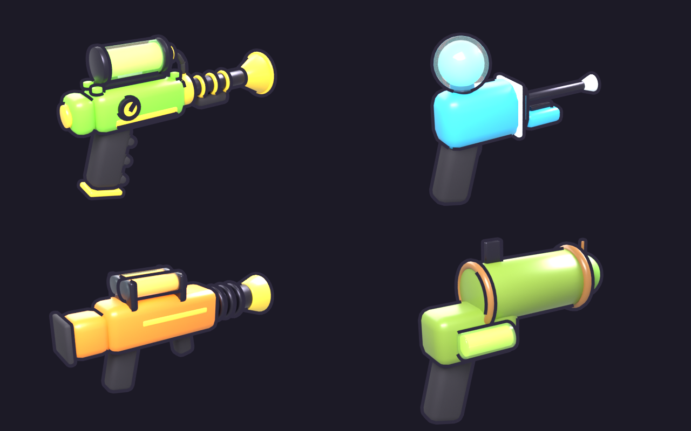
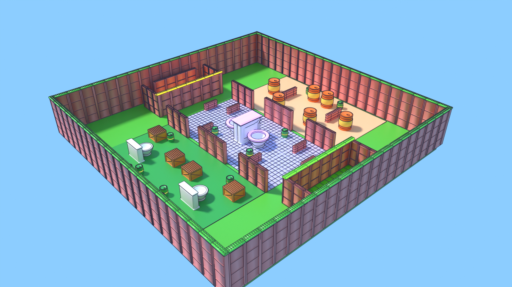
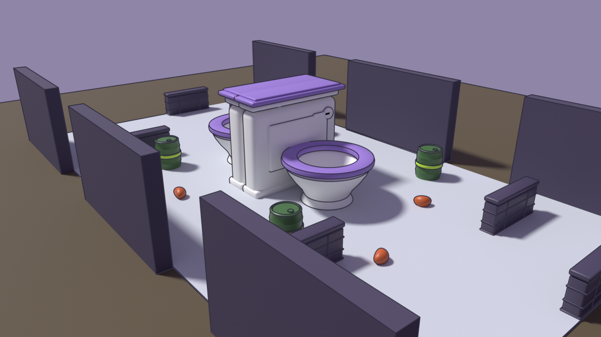
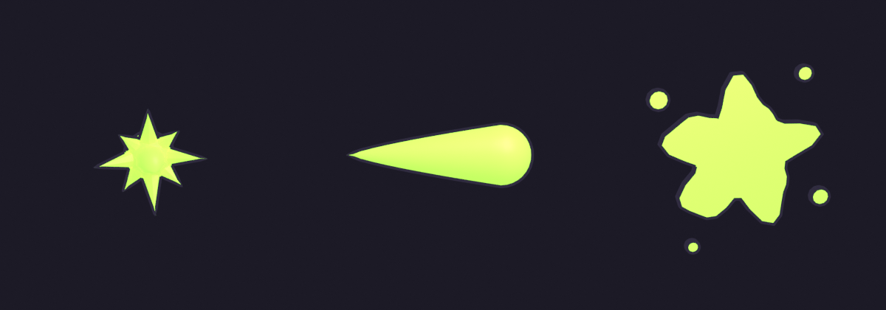

# Fart Wars art (Blender)

The four weapons, their hotbar icons, the shot effects, the effect
textures and the map (its props, walls and floors) are made in Blender,
from scripts in `art/blender`. The scripts are the source: change a weapon
or a prop there and run them again, and the game's copy of the
measurements (`src/shared/Config/WeaponArt.luau`, `PropArt.luau`,
`ShotArt.luau`) and of the weapon and shot meshes themselves
(`src/shared/MeshData`) is regenerated to match.







| Folder | What's in it |
| --- | --- |
| `art/blender/build_weapons.py` | models the Gas Blaster, Spritzer, Thunderclapper and Stink Lobber, with their moving parts (the pumps, the gauge's needle, the Stink Lobber's bomb) |
| `art/blender/build_effects.py` | the particle textures: puff, cloud, spark, ring, droplet |
| `art/blender/build_shots.py` | the shots' meshes: the muzzle burst, the gas bolt a shot streaks as, the splat where it hits and the shock ring |
| `art/blender/build_props.py` | the map: the throne's toilet tank, lid, bowl and seat; the bean can and its label; the gas barrel and its band; the crate; the cover wall; Bean Rain's bean; the walls (two heights), the studded wall-top plates, the plaza's tiles, the spawn floors and the spawn pads |
| `scripts/map_layout.py` | writes `art/export/props/layout.txt`: the map as the game builds it, dressed (run on the spec harness), for the map renders |
| `art/blender/kit.py` | shared helpers (axes, materials, rendering) |
| `src/shared/MeshData/<Weapon>.luau`, `Shots.luau` | the weapon and shot meshes packed small, which the game builds itself (`MeshBuilder`): nothing to import |
| `art/export/weapons/<Weapon>.fbx` | the model for Studio's importer, if you'd rather import it: one mesh per role (Body, Metal, Grip, Trim, Glass, Gas, Bomb) and per moving part (Pump, Needle, Fuse) |
| `art/export/weapons/<Weapon>.blend` | the same model as a Blender scene, to edit by hand |
| `art/export/weapons/<Weapon>.png`, `all.png` | preview renders |
| `art/export/icons/<Weapon>.png` | hotbar icons, 512×512 |
| `art/export/effects/<name>.png` | particle textures, white (the game tints them) |
| `art/export/effects/MuzzleBurst.fbx`, `GasBolt.fbx`, `Splat.fbx`, `ShockRing.fbx`, `shots.png` | the shots' meshes for Studio's importer, and a render of the four |
| `art/export/weapons/manifest.json` | every part's size and place, which the game reads (through `WeaponArt.luau`) |
| `art/export/props/<Prop>.fbx` | each mesh for Roblox: a prop the exact size of the map part it dresses, or a wall or floor module the game repeats along its part |
| `art/export/props/Props.blend`, `<Prop>.png`, `all.png` | every mesh in one Blender scene; previews (modules shown repeated) |
| `art/export/props/map.png`, `plaza.png`, `spawn.png` | the whole map, Porcelain Plaza and a spawn room, rendered from `layout.txt` |
| `art/export/props/manifest.json` | each mesh's size, the part it was modelled on and, for a module, the axes it repeats along (`PropArt.luau`) |

## What the game does with it

The held gun is always built from the Blender model's measurements
(`WeaponModel`):

- **Nothing to import.** The game builds the Blender meshes itself on
  each player's device (`MeshBuilder`, Roblox's EditableMesh, from the
  packed copies in `src/shared/MeshData`) and dresses every gun in them
  (`WeaponSkin`) a moment after it appears. The server's gun is the
  stand-in below (a mesh built on the server wouldn't reach the players),
  and each client covers it with the meshes.
- **In a published game** EditableMesh is off until you turn on
  **Experience Settings → Security → Allow Mesh / Image APIs** (Roblox
  asks for 13+ age and ID verification for it). In Studio it works as it
  is. `/fw selftest` checks it; without it the output says why and the
  guns are the stand-in.
- **The stand-in** is built from the same blocks, cylinders and balls the
  Blender model is made of, in the same colours: the shape is right,
  without the bevels and round edges. It's what you see for the first
  moment, and if meshes can't be built.
- **Imported meshes** (optional, below) win over everything: each sized
  and placed from the model's measurements, so the import's scale or
  position doesn't matter.

The animations are done in code, so there's nothing to upload for them
(`WeaponFx`, `WeaponFxController`):

- the gun swings up when it's equipped, overshooting a little; the Gas
  Blaster and the Spritzer twirl round the barrel on the way;
- every shot kicks it back, up and a little to a side, and springs bring
  it back, past rest and home; the Stink Lobber's kick is its throw;
- standing still it sways a little; walking, it bobs with the steps;
- the moving parts: the pumps pump on every shot, the Gas Blaster's
  gauge needle drops as its pressure does and climbs back, and the Stink
  Lobber's bomb is gone when it's thrown and grows back as it reloads;
- the gas in the tank and the vents glows slowly and flashes white on
  every shot, and a burst of shots leaves the barrel smoking.

Every player sees everyone's. Reduce motion keeps a little recoil and none
of the rest.

The hotbar shows each weapon's 3D model until its icon is uploaded, and
the locker's weapon cards turn the model slowly.

The shots (`ShotFx`, sizes per weapon in `WeaponFx`): each hitscan shot
streaks as a glowing gas bolt, a hot core in a softer glow, from the gun's
muzzle to where it stopped (your own shots stop at the first wall in the
way, as far as your screen can tell), lighting the walls it passes and
leaving a trail of smoke (the Spritzer's, droplets), and slides into its
target. The muzzle flashes a cartoon burst and a flash of light, and a
shock ring spreads from it; your own shots kick your camera a little.
Where a shot hits a wall or floor, a splat sticks for a moment (never to
a player), with a ring, a puff, sparks and a flash of light; a player
your shot hits flashes white. They're in the shot's colour: the shooter's
team, or their tracer cosmetic. Reduced effects and reduce motion leave
out the bursts, rings, splats, lights, trails and smoke; the bolt always
shows.



The map's props dress the parts the map is built from (`MapDressing`,
`Config/MapArt.luau` says which prop goes on which part):

- **Without importing anything**, each player's game builds the props
  from the packed copies in `src/shared/MeshData/Props.luau` (written by
  `build_props.py`, like the guns') and dresses the map itself
  (`MapArtController`, `MapDressing.dressRuntime`): the same pieces in the
  same places, on that player's screen only, with the parts hidden there
  and a barrel's art following the barrel. It needs Allow Mesh / Image
  APIs on, like the guns; without it the map is its plain blocks and
  cylinders.
- **Once a prop is imported**, the server dresses every part with it
  instead, drawing the mesh exactly over it, in the part's own colour and
  material. The part stays
  where it is, invisible, as the hitbox: it's still what players bump
  into, what shots hit and what stops a blast, and the mesh can't be hit,
  touched or collided with. So cover, sightlines and barrels play exactly
  the same with or without the art.
- The throne's two toilets face their own bowls, the Gas Gutter's sideways
  toilet turns to face its bowl, and a gas barrel's mesh goes and comes
  back with the barrel. Bean Rain's beans use the bean mesh.
- Walls, wall trims and floors are **modules**: a wall is a row of 8-stud
  wall sections, a floor a grid of 10-stud tiles (8 for the spawn
  floors), as many as fit, each stretched a little so they come out
  even. So a 164-stud wall isn't one stretched mesh. The modules' ends
  are made to meet: wall sections share a post (and an open end of a
  wall shows a clean post) and floor tiles keep the same gaps across
  their edges. Walls, trims and the see-through spawn floor are single
  shapes with no faces lying on each other, so nothing flickers.
- The spawn pads are dressed too, and still work as spawns.
- **The look is building bricks**: bright toy colours (`MapConfig`'s
  theme) on plastic, with studs. The tops of the walls, the wall-top
  plates, the cover walls and the crates have real studs, one stud
  apart. The ground and the side lanes aren't meshes at all: they're
  plastic baseplates with Roblox's own stud surface (the plain map's
  plastic blocks all get it, `MapKit.studded`), which no mesh could match
  for the cost on floors that big. The plaza keeps its smooth tiles.
- Every mesh has UVs measured in studs, so Roblox's material textures land
  on the meshes at an even size and run on from one module to the next.

## Import the meshes into Studio (optional)

The game builds the weapon and shot meshes itself, so this is only for
when you'd rather have them as imported assets (or meshes can't be built
in your game).

1. Open the place in Studio, with Rojo connected.
2. **Model** tab (or File) → **Import 3D**. Pick
   `art/export/weapons/GasBlaster.fbx`.
3. In the importer, keep the default orientation (forward **-Z / Front**,
   up **+Y / Top**) and leave **merge meshes off**, so each part of the gun
   stays its own MeshPart. Import.
4. A model named `GasBlaster` appears in the Workspace with MeshParts named
   Body, Metal, Grip, Trim, Glass, Gas, Pump and Needle. Drag it into
   **ReplicatedStorage → Assets → Weapons**. Keep its name.
5. Do the same for `Spritzer.fbx`, `Thunderclapper.fbx` and
   `StinkLobber.fbx`.
6. Play, and chat `/fw selftest`: **Weapon meshes: all 4 imported**. If it
   says a part is "the wrong way round", delete that weapon's model and
   import it again with the orientation above.

Rojo leaves `ReplicatedStorage.Assets` alone, so the imports stay when you
sync. Save the place in Studio to keep them. To keep them in Git too,
right-click **Weapons** → **Save to File** → `art/export/Weapons.rbxm`.

## Import the shot effects (optional)

1. **Import 3D** `art/export/effects/MuzzleBurst.fbx`, `GasBolt.fbx`,
   `Splat.fbx` and `ShockRing.fbx` (forward **-Z**, up **+Y**).
2. Drag each into **ReplicatedStorage → Assets → Effects**, keeping its
   name.
3. `/fw selftest`: **Shot effects: all 4 imported**.

Without imports or built meshes each shot is drawn with glowing parts in
the same places: a block for the bolt, a ball for the burst, discs for
the ring and the splat.

## Import the map props (once)

1. **Import 3D** each FBX in `art/export/props` (ToiletTank, TankLid,
   ToiletBowl, ToiletSeat, BeanCan, BeanLabel, GasBarrel, BarrelBand,
   Crate, CoverWall, Bean, Wall, TallWall, WallTrim, PlazaTiles,
   SpawnTiles, SpawnPad), with the same
   orientation as the weapons (forward **-Z**, up **+Y**). The importer
   takes several files at once.
2. Drag each one into **ReplicatedStorage → Assets → Props** and keep its
   name. A MeshPart on its own or the Model the importer makes around it
   are both fine.
3. For performance: select them all and set **CollisionFidelity** to
   **Box** (the meshes never collide; the parts under them do). The
   dressed map is about 370 meshes, mostly wall and floor modules.
4. Play, and `/fw selftest`: **Map props: all 17 imported**. A prop that's
   "the wrong way round" is left off the map (its parts show as before);
   import it again. You can import a few at a time: each one dresses its
   parts as soon as it's there (on the next map load).

Save the place to keep them; to keep them in Git too, right-click
**Props** → **Save to File** → `art/export/Props.rbxm`.

## Upload the images (once)

1. **View** → **Asset Manager** → **Bulk Import**. Pick the four PNGs in
   `art/export/icons` and the five in `art/export/effects` (not `all.png`).
2. Right-click each uploaded image → **Copy Asset ID**, and paste it into
   `src/shared/Config/ArtAssets.luau` (`icons` for the four weapons,
   `effects` for puff, cloud, spark, ring and droplet). Numbers on their
   own are fine.
3. `/fw selftest`: **Art images: all 9 uploaded**.

Until then the hotbar shows the 3D models, and the particles use Roblox's
own textures.

## Changing the art

You need Blender 4.2 or newer, or just its Python module:

```
pip install bpy==5.2.3          # Python 3.13
python art/blender/build_weapons.py
python art/blender/build_shots.py
python art/blender/build_effects.py
python art/blender/build_props.py
```

or, with Blender installed:

```
blender --background --python art/blender/build_weapons.py
blender --background --python art/blender/build_shots.py
blender --background --python art/blender/build_effects.py
blender --background --python art/blender/build_props.py
```

Each weapon is a short function in `build_weapons.py` (`gas_blaster`,
`spritzer`, ...), made of `box`, `cyl`, `ball` and `ring` calls with
sizes in studs. The grip is at the origin; the barrel points along
Blender's +Y and the top is +Z. The colours are at the top of the file.
A piece given `part="Pump"` becomes part of a moving part of that name
(all one role), a mesh of its own that turns and scales round its own
centre; `WeaponFx` says how it moves. After a change, run the specs
(`python3 scripts/run_specs.py`) and check the renders; the game picks
up the new meshes from `src/shared/MeshData` (if you imported the old
ones, import the changed FBX again, replacing the old model in Assets →
Weapons).

Each prop is a function in `build_props.py` (`toilet_tank`, `bean_can`,
...), modelled at the exact size of the map part named in `PROPS`, so it
isn't stretched in the game. A wall or floor module (`wall_tile`,
`floor_module`, `spawn_tiles`) is one section of its part; `tile` in
`PROPS` says which way it repeats, and `texture` how big the material's
texture is on it (a size that divides the module, so the texture runs on
across modules). `studs` puts building-brick studs on a top (modelled
`STUD_HEIGHT` below the part's top, so the studs stay inside its box). The map renders come from `layout.txt`, which the script
refreshes with `scripts/map_layout.py` when `luau` is installed;
`python art/blender/build_props.py renders` redoes just the renders. Cylinder props (bowl, seat, can, label,
barrel, band) are turned shapes around Blender's X, the axis a Roblox
cylinder part runs along; the map stands them up. A prop whose front
matters faces Blender +Y. The spec `MapArt` checks every prop still fits
its part. To dress another part, add it to `Config/MapArt.luau`.
